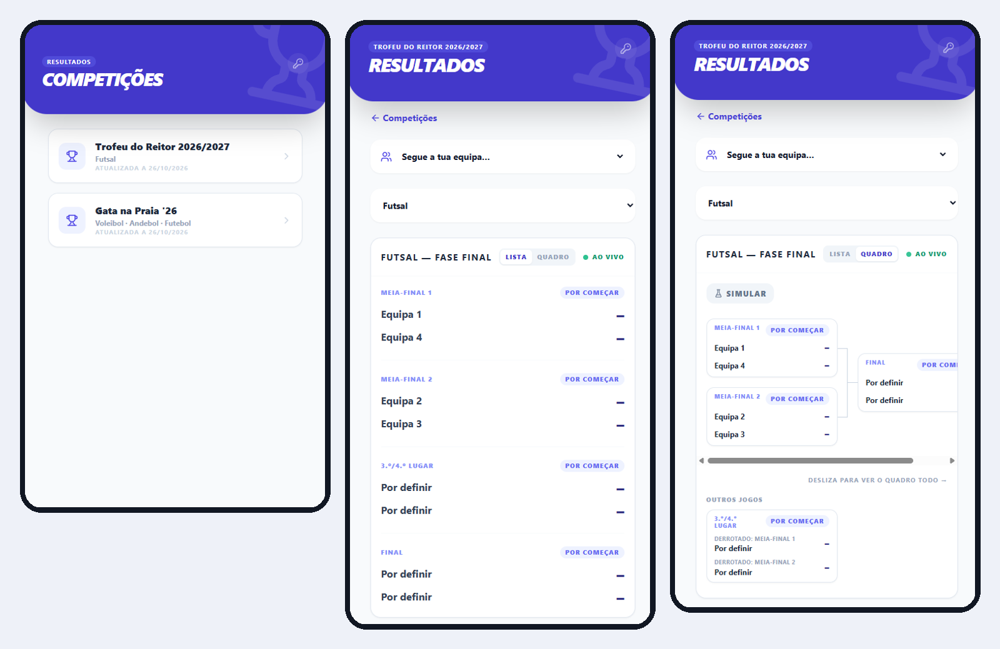

# Resultados · Live results platform for student competitions

[](https://github.com/telmomaciel9/Plataforma-de-Resultados/actions/workflows/ci.yml)

**Live:** [plataforma-de-resultados.vercel.app](https://plataforma-de-resultados.vercel.app)

Mobile-first platform for running sports competitions: pick a competition, follow fixtures and results live, and let organisers set up teams and brackets from their phones. It started as the app for the sports tournament at **Gata na Praia 2026**, an event organised by the University of Minho Students' Union (AAUMinho), where players and spectators followed every match while the organisers entered scores from the pitch.

**In numbers:** 27 teams · 3 sports (volleyball, handball, football) · 81 matches · scores pushed live to every open phone.



## Highlights

- **Many competitions, one app.** The home page lists every competition; each one lives at its own address (`/c/<competition>`). Organisers create a new competition from the app (name, edition, sports, number of groups) and it opens straight into team setup.
- **Live scores.** Results change on every open phone as soon as an organiser publishes them (Supabase Realtime), and the page catches up when a phone comes back from the background.
- **Several organisers at once, without lost updates.** Each admin keeps a list of their own changes instead of a copy of the tournament. Publishing applies those changes on top of the latest version and only saves if nobody else saved in between (optimistic concurrency on a `version` column); otherwise it retries. Admins are told when they overwrote someone else's value or edited a match that was deleted meanwhile.
- **Automatic bracket.** A match side can be a team or a reference such as "winner of the group A final" or "loser of semi-final 1". Teams move up as soon as a result is in, and draws can be settled with a tiebreak (penalties, golden point). The admin can only pick references that do not create a cycle.
- **Reusable for other tournaments, set up from the app.** Organisers change the name and edition, add or remove sports and groups, and manage each group's teams (renaming a team updates every match). One tap generates a group's whole knockout for any number of teams, with byes for the top seeds, and the knockout stage between group winners for any number of groups, all wired with "winner of match X" / "loser of match Y". After generating, two teams can swap places (also across groups) in every match that has not started. Generating is blocked once a match in that group has started.
- **Secure by default.** Row Level Security lets anyone read but only signed-in admins write. The app detects a write silently blocked by RLS instead of reporting success.
- **Tested logic.** All tournament rules live in plain TypeScript (`lib/tournament/`, no React or Supabase) with 147 Vitest tests, plus component tests (Testing Library) for the bracket, its simulation, the tournament setup panel, the new competition form and the admin sign-in. CI runs lint, type checks, tests and a production build on every push.

## Features

**Public view**
- Home page with every competition; old links to the 2026 tournament still work
- Competitions with groups and then a knockout stage, or a straight knockout with no groups
- Only the public pages are visible; a discreet button in the corner of the header lets organisers sign in, and only then do the editing tools appear
- Follow your team: a page per team (`/c/<competition>/equipa/<team>`) with its record, the match it is playing now or plays next, what comes next if it wins or loses, and its matches grouped by sport with a record per sport; the team you follow is remembered on your phone
- Every match shows whether it is upcoming, live or finished, plus its time
- **Bracket view** of each group and of the knockout stage, drawn as a tree from the first matches to the final. Links come from the match references or, for hand-typed team names, are worked out from who won each earlier match
- **Simulate**: tap the team you think wins each unfinished match and see who would go through; nothing is saved
- Shareable links to a sport, group and view, e.g. `?modalidade=Voleibol&grupo=Finais&vista=quadro`
- Pick a sport and a group or the knockout stage
- See every match with its pitch, teams and score; winners highlighted, unplayed matches shown as "–"
- Knockout stage with semi-finals, 3rd/4th place match and final

**Admin view**
- Email and password sign-in with Supabase Auth
- Create a competition from the home page
- **Tournament and teams:** swap two teams after generating; name, edition and page title; sports; groups; teams per group in seed order; generate a group's matches or the knockout stage, with a bracket preview before publishing
- Add, edit and delete matches in any group or in the knockout stage
- Choose each side from the teams, a group winner, or the winner or loser of another match
- Tiebreak winner for drawn matches
- Match time and status (upcoming, live, finished); only a finished match sends its winner to the next round, so a partial score never advances anyone
- Publish all changes in one save, or discard them; warning before leaving with unpublished changes

## Tech stack

| | |
|---|---|
| Framework | Next.js 14 (App Router), React 18 |
| Backend | Supabase: PostgreSQL, Auth, Realtime, Row Level Security |
| Language | TypeScript (tournament logic), JavaScript (UI) |
| Styling | Tailwind CSS 3, Lucide icons |
| Quality | Vitest, ESLint, GitHub Actions; Vercel previews for every pull request |

## How it works

```
Phone (public)  ◄── Realtime ──┐
                               │
Admin ── edits ──► publishEdits ──► load latest ─► apply edits ─► save if version unchanged
                               │                                     │
                               └──────────── retry on conflict ◄─────┘
                                             Supabase: app_state (payload jsonb, version)
```

Each competition is one row of the `app_state` table (its `id` is the address, `/c/<id>`) holding a single JSON document, so the structure of groups and stages can change without database migrations. Every save bumps `version` through a trigger, which is what makes concurrent publishing safe.

## Getting started

Requirements: Node.js 20 or newer (22.18+ for `npm run novo-torneio`) and a free [Supabase](https://supabase.com) project.

**1. Install**

```bash
git clone https://github.com/telmomaciel9/Plataforma-de-Resultados.git
cd Plataforma-de-Resultados
npm install
```

**2. Configure Supabase.** Create a `.env.local` file:

```bash
NEXT_PUBLIC_SUPABASE_URL=https://<project>.supabase.co
NEXT_PUBLIC_SUPABASE_ANON_KEY=<anon-key>
```

**3. Create the table** in the Supabase SQL editor:

```sql
create table app_state (
  id text primary key,
  payload jsonb not null,
  updated_at timestamptz default now()
);
```

**4. Lock it down and turn on live updates.** The anon key ships to every browser, so Row Level Security is what stops visitors from editing results. Run, in order:

- [`supabase/policies.sql`](supabase/policies.sql): everyone can read, only signed-in admins can update, nobody can insert or delete rows from the app.
- [`supabase/realtime-e-versao.sql`](supabase/realtime-e-versao.sql): the `version` column used for concurrent publishing, and Realtime for the table. The app still works without it, with no live updates and last save wins.
- [`supabase/competicoes.sql`](supabase/competicoes.sql): lets signed-in admins create competitions from the app. Deleting a competition is only possible in the SQL editor.

**5. Create the admin users** under Authentication → Users in Supabase.

**6. Create competitions** from the home page: sign in with the key button in the top-right corner, then "Nova competição" (groups and then a knockout stage, or a straight knockout). [`tournament.config.json`](tournament.config.json) sets the platform name and the defaults for new competitions; its `id` is the competition that old links (without `/c/<id>`) open. Optionally, `npm run novo-torneio` writes `supabase/novo-torneio.sql` to create that competition from the SQL editor instead.

**7. Run**

```bash
npm run dev
```

The app runs at `http://localhost:3000`.

## Data format

```json
{
  "modalities": ["Voleibol", "Andebol", "Futebol"],
  "groups": {
    "Voleibol": { "A": { "matches": [] }, "B": { "matches": [] }, "C": { "matches": [] }, "D": { "matches": [] } }
  },
  "finals": { "Voleibol": [] }
}
```

Each match is `{ "id", "stage", "home", "away", "homeScore", "awayScore" }`, plus an optional `tiebreakWinner` for drawn matches. Scores are strings and stay `""` until the match is played.

`home` and `away` are usually team names, but they can also point to another match:

| Slot | Meaning |
|---|---|
| `WIN:<match id>` | Winner of that match |
| `LOSS:<match id>` | Loser of that match (e.g. 3rd/4th place) |
| `WIN_GROUP:<sport>:<group>` | Winner of the group: the winner of its last match, or of `finalMatchId` if the group sets one |

## Checks

```bash
npm run lint        # ESLint (next/core-web-vitals)
npm run typecheck   # TypeScript
npm test            # Vitest: tournament logic
npm run build
```

## Project structure

```
app/
├── layout.jsx                  # Root layout and metadata
├── page.jsx                    # Home: list and create competitions
├── c/[id]/page.jsx             # A competition: public view, "my team" shortcut and admin panel
├── c/[id]/equipa/[slug]/       # Team page
├── equipa/[slug]/page.jsx      # Old team links, redirected to the 2026 competition
├── NewCompetitionForm.jsx      # New competition form (+ test)
├── AdminLogin.jsx              # Admin sign-in and the discreet header button (+ test)
├── ui.jsx                      # Shared components (header, match row, status badge)
├── Bracket.jsx                 # Bracket view and simulation (+ Bracket.test.jsx)
├── TournamentSetup.jsx         # Admin: tournament, sports, groups, teams, generate brackets (+ test)
└── globals.css                 # Tailwind entry point
lib/
├── appState.ts                 # Supabase: competitions, load, versioned save, live subscription
├── useTournament.js            # React hooks: live competition data, admin session; followed team
└── tournament/                 # Tournament rules in TypeScript, with tests
    ├── resolve.ts              #   winners, losers and group winners
    ├── edits.ts / publish.ts   #   admin edits and conflict-safe publishing
    ├── slots.ts                #   what each match side can point to, cycle checks
    ├── team.ts                 #   a team's matches, next match and what comes next
    ├── bracket.ts              #   bracket tree of a group or the knockout stage; simulation
    ├── generate.ts             #   generated knockouts for groups and the knockout stage
    ├── swap.ts                 #   swap two teams in matches that have not started
    ├── competition.ts          #   new competitions: address, validation, initial state
    └── config.ts               #   tournament config, settings and new-tournament template
scripts/novo-torneio.mjs        # Generates the SQL for the default competition
supabase/                       # RLS policies, version column, Realtime, creating competitions
tournament.config.json          # Platform name, default competition and defaults for new ones
prototypes/                     # Earlier versions, not served by Next.js
```

## Author

**Telmo Maciel** · [GitHub](https://github.com/telmomaciel9) · [LinkedIn](https://www.linkedin.com/in/telmo-maciel/)
